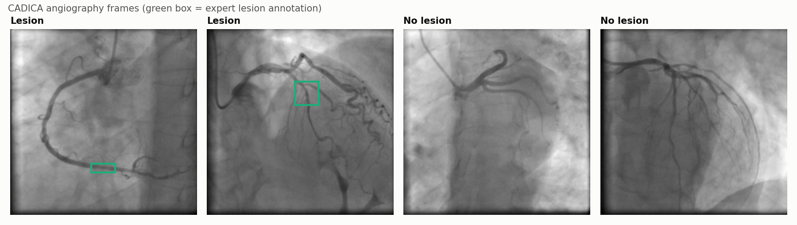
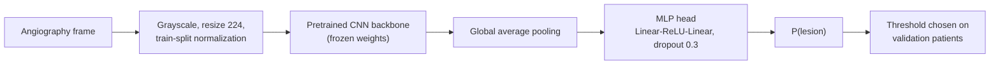
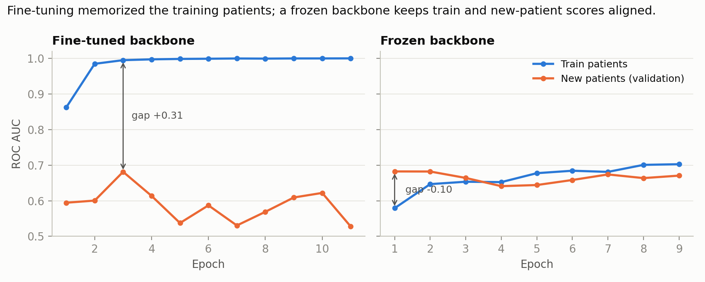
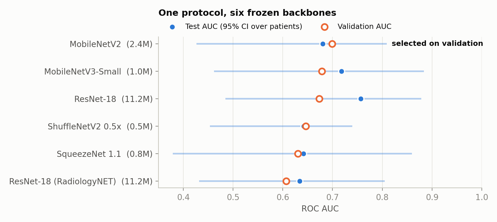

# Coronary Lesion Classification in X-ray Angiography

**Deep learning that detects coronary artery lesions in invasive coronary angiography, evaluated the way it would be used clinically: on patients the model has never seen.**

[](https://huggingface.co/spaces/saighim/coronary-lesion-classifier)
[](https://github.com/MarwaSaighi/coronary-lesion-classifier/actions/workflows/tests.yml)




Research internship project (M2) at **GIPSA-lab, Université Grenoble Alpes**, in collaboration with **CHU Grenoble Alpes**.

## Highlights

- **End-to-end pipeline** from the raw public [CADICA](https://doi.org/10.1111/exsy.13708) dataset (42 patients, 6,126 annotated frames) to a deployed web demo.
- **Patient-level evaluation, enforced in code.** Every frame and video of a patient lives in exactly one split. An automated audit fails the pipeline if a patient or video ever crosses splits.
- **Diagnosed and fixed overfitting.** Fine-tuning reached a training AUC of 0.99 while new-patient AUC stayed at 0.68. Switching to a frozen pretrained backbone with a small MLP head cut the train/validation gap from +0.31 to +0.09.
- **Controlled comparison of six backbones** (0.5M–11.2M parameters), including medical-domain pretraining (RadiologyNET). All share one training protocol. Best test ROC AUC: **0.76**.
- **Statistically careful model selection.** Models were chosen on validation, never on test, and reported with patient-level bootstrap confidence intervals.
- **HPC engineering.** Resumable GPU training jobs on the GRICAD cluster (OAR scheduler), with checksum-verified result transfer.
- **Deployed.** The validation-selected MobileNetV2 (2.4M parameters) runs on CPU in a [Gradio demo](https://huggingface.co/spaces/saighim/coronary-lesion-classifier).

## The problem

Coronary artery disease narrows the arteries that supply the heart. During invasive coronary angiography, cardiologists judge narrowing visually from X-ray video, and those judgements vary between observers and hospitals. An automated second reader needs to work on **new patients**, not on the ones it was trained on.

That makes evaluation the hard part. CADICA has many frames per patient but only 42 patients, and frames from the same patient are nearly identical. A random frame-level split would put near-copies of test images in the training set and inflate every metric. This project is built around avoiding that.

## Data and split

| Split | Patients | Lesion frames | Non-lesion frames |
|---|---:|---:|---:|
| Train | 30 | 2,589 | 1,521 |
| Validation | 6 | 788 | 263 |
| Test | 6 | 619 | 346 |

A frame is labelled *lesion* when it belongs to a video the CADICA experts annotated as containing a lesion. Only the expert-selected frames of each video are used. The split was drawn once with a fixed seed and frozen before any experiment. [`scripts/prepare_data.py`](scripts/prepare_data.py) rebuilds it from the original `CADICA.zip` and runs the leakage audit.

## Method



- **Frozen backbone, adapted statistics.** Convolutional weights stay fixed. Only the BatchNorm running statistics adapt to angiography images, and only the MLP head is trained (66k–164k parameters).
- **Training:** AdamW (lr 1e-3, weight decay 1e-4), batch size 32, cross-entropy, light geometric and intensity augmentation, and early stopping on validation ROC AUC.
- **Decision threshold:** chosen to maximize balanced accuracy on validation patients, then frozen before touching the test set.
- **Uncertainty:** 95% confidence intervals from a bootstrap that resamples whole **patients**, not frames, because frames from one patient are strongly correlated.

## Results

### 1. Catching overfitting early



Fine-tuning the last ResNet-18 block let the network memorize the 30 training patients: training AUC 0.99, validation AUC 0.68. A frozen backbone reached the same validation performance with no memorization gap, so every later experiment uses frozen backbones and spends its capacity on the comparison that matters.

### 2. Backbone comparison under one protocol



| Backbone | Params | Pretraining | Val AUC | Test AUC [95% CI] | Test bal. acc. |
|---|---:|---|---:|---:|---:|
| **MobileNetV2** (selected) | 2.4M | ImageNet | **0.699** | 0.680 [0.43, 0.81] | 0.636 |
| MobileNetV3-Small | 1.0M | ImageNet | 0.679 | 0.718 [0.46, 0.88] | 0.630 |
| ResNet-18 | 11.2M | ImageNet | 0.673 | **0.757** [0.49, 0.88] | 0.656 |
| ShuffleNetV2 0.5x | 0.5M | ImageNet | 0.646 | 0.642 [0.45, 0.74] | 0.578 |
| SqueezeNet 1.1 | 0.8M | ImageNet | 0.630 | 0.642 [0.38, 0.86] | 0.584 |
| ResNet-18 | 11.2M | RadiologyNET (medical) | 0.607 | 0.634 [0.43, 0.81] | 0.576 |

Full per-model metrics: [`results/model_comparison.csv`](results/model_comparison.csv). Per-frame predictions for every model are in [`results/predictions/`](results/predictions/).

### What the results show

1. **Small models are competitive.** MobileNetV3-Small reaches 0.72 test AUC with one eleventh of ResNet-18's parameters, which matters for running on hospital hardware.
2. **Medical-domain pretraining did not beat ImageNet here.** The same ResNet-18 scored lower with RadiologyNET weights than with ImageNet weights (0.63 vs 0.76). "Medical pretraining helps medical tasks" is worth testing, not assuming.
3. **Model selection must not peek at the test set.** Validation ranks MobileNetV2 first while test favours ResNet-18. Choosing the model by its test score would leak test information into the decision, so the deployed model is the validation choice.
4. **The next gain comes from more patients, not a bigger model.** With six test patients the intervals are wide and overlapping, so the evaluation supports "competitive" rather than a fixed ranking. The highest-value next step is a larger, multi-centre patient cohort.

## Next steps

- External validation on an independent clinical cohort.
- Video-level and patient-level aggregation of frame predictions, closer to how a cardiologist reads an exam.
- Lesion localization using CADICA's expert bounding boxes as supervision.

## Reproduce

```bash
git clone https://github.com/MarwaSaighi/coronary-lesion-classifier.git
cd coronary-lesion-classifier
pip install -e ".[dev]"

# 1. Data: download CADICA (link in the paper below), then
python scripts/prepare_data.py --cadica path/to/CADICA.zip --out data/cadica

# 2. Train one backbone (GPU recommended; CPU works)
python -m angio_cls.train --config configs/mobilenet_v2.yaml --data data/cadica --out runs

# 3. Evaluate every trained run: validation threshold, test metrics, bootstrap CI
python -m angio_cls.evaluate --runs runs --data data/cadica --out results

# 4. Figures and tests
python scripts/make_figures.py
pytest
```

To run on an OAR-scheduled GPU cluster, see [`cluster/`](cluster/README.md). To run the demo locally: `python scripts/export_demo_model.py runs/mobilenet_v2/best.pt demo/model.pt --threshold 0.57`, then `PYTHONPATH=src python demo/app.py`.

## Repository layout

```
src/angio_cls/     data prep + split audit, models, training, evaluation, metrics, Grad-CAM
configs/           one YAML per backbone
scripts/           data preparation, figures, demo export
cluster/           OAR job scripts and HPC notes
results/           metrics, per-frame predictions, training histories
demo/              Gradio app (Hugging Face Space)
tests/             split/leakage, model, and metric tests
```

## Stack

PyTorch · torchvision · scikit-learn · pandas · matplotlib · Gradio · Hugging Face Spaces · OAR/HPC (NVIDIA V100/A100)

## Acknowledgements

Carried out with **Dawood Al Chanti** (GIPSA-lab, Université Grenoble Alpes) and **Gilles Barone-Rochette** (CHU Grenoble Alpes). Computations were run on the GRICAD infrastructure.

**Data.** A. Jiménez-Partinen *et al.*, "CADICA: A new dataset for coronary artery disease detection by using invasive coronary angiography," *Expert Systems*, 41(12):e13708, 2024. [doi:10.1111/exsy.13708](https://doi.org/10.1111/exsy.13708). The dataset is not redistributed here. The six demo frames are taken from it, with attribution.

**Medical pretraining.** M. Napravnik *et al.*, "Lessons learned from RadiologyNET foundation models for transfer learning in medical radiology," *Scientific Reports* 15:21622, 2025.

*Research code only. Not a medical device and not intended for clinical use.*

## Author

**Marwa Saighi**, [GitHub](https://github.com/MarwaSaighi) · [Hugging Face](https://huggingface.co/saighim)
